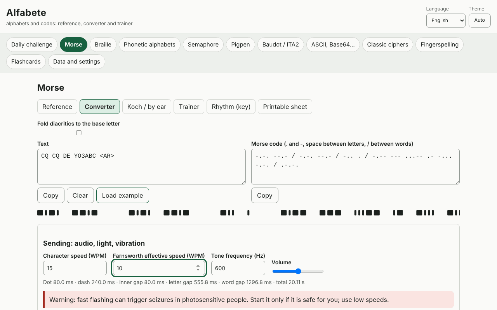

# Alfabete

**English** · [Română](README.ro.md) · [Français](README.fr.md) · [Italiano](README.it.md) · [Español](README.es.md) · [Português](README.pt.md) · [Deutsch](README.de.md) · [Magyar](README.hu.md)

**Version:** 2.1.0 · **Last updated:** 2026-10-27

**Status:** stable · **Offline:** complete (no network requests)

Interface languages: **Română, English, Français, Italiano, Español, Português (PT), Deutsch, Magyar**

Alfabete is an offline app for alphabets and codes: for each code you get a visual reference, a two-way converter, a trainer with answer checking and a printable sheet. It covers Morse (audio with WPM/Farnsworth, light, vibration, Koch, ear training, rhythm), Latin grade 1 braille (Unicode, BRF, SVG, Perkins-style writing), phonetic alphabets (ITU/NATO, Romanian, DIN 5009, French), semaphore, pigpen, Baudot/ITA2, ASCII/binary/hex/octal/Base64/URL/Unicode escapes, classical ciphers with explained steps and frequency analysis, the daily challenge and spaced-repetition cards (SM-2). It complements the Eter (Morse/Koch) and Atingere (braille) apps.

**Live app:** https://chiuta.github.io/apps/Alfabete/

## How to use

Pick a panel from the top bar, then a sub-tab: Reference, Converter, trainer, Printable sheet. In the converters you type in either field and the other one updates. For Morse you can play the sound, light or vibration (where the browser allows it) and export WAV. For braille you can download BRF or SVG. The "Daily challenge" is generated deterministically from the date. The language (ro, en, fr, it, es, pt, hu, de) and the theme (automatic/light/dark) are changed from the header; the text you entered is kept.

## What it does NOT do, and limits

- Braille: only **grade 1** (letter by letter). Grade 2 (contractions) is not implemented and is not claimed. The Romanian letters (ă â î ș ț) have not been checked against an official source: selectable profiles are offered (working, fold to base letter, custom), labelled as such. Punctuation varies between languages.
- The Romanian phonetic alphabet, Morse diacritics and national variants are not standardized; they are marked "unofficial"/"variant". The ITU/NATO ones and the ITU-R M.1677-1 signs are the standard ones.
- Fingerspelling: **no figures** (we do not draw approximate hands); only short descriptions and a pointer to official sources. The ASL descriptions and the meaning of prosigns appear in English outside the ro/en languages.
- Semaphore: the table was cross-checked against a public source, but it deserves checking against an official source; the signs for numerals and cancel are not drawn.
- The classical ciphers are didactic and **offer no security**. The attack on Caesar/Vigenère works on sufficiently long texts, in English or with custom frequencies.
- Vibration depends on the Vibration API (missing on iOS/desktop); fast flashing light can affect photosensitive people.

## Privacy

It runs locally and sends nothing anywhere. The only data (settings, statistics, cards, drafts) is kept in localStorage under the prefix `fff.alfabete.`.

## Formats

Data export/import: `.fff.json` (`fff-bundle` format, schema 1). Outputs: WAV (Morse), BRF and SVG (braille), printable sheets (print/PDF).

## Technical

A single `index.html` file, inline JS and CSS, strict CSP with a hash, no external resources. Tests: `node tests/test.mjs` (Playwright; 44 tests: known vectors, round trip for every code, Morse durations computed and measured on rendered audio/blinking, axe 0 in both themes, layout at 360 and 1280 px).

## Third parties

It uses no third-party code.

## Translations

Romanian and English are written by hand; French, Italian, Spanish, Portuguese, Hungarian and German are machine translations, not verified by native speakers.

## License

MIT — see the `LICENSE` file at the repository root.

## News in 2.1.0 and what is not implemented (2026-10-27)

- **Timed round (60 s)** on every trainer (Morse, braille, phonetic, semaphore, pigpen, Baudot, ASCII/binary, ciphers): the button starts a 60 s countdown, moves on to the next question automatically after each answer and at the end shows how many answers were correct and your **best result** (kept locally inside `stats`, with no new storage key). The texts exist in all 8 languages (fr/it/es/pt/hu/de are machine translations).
- **Morse audio**: already existed (sound with WPM/Farnsworth, light, vibration, WAV export) — unchanged.
- **Braille grade 2** (contractions): **planned, not implemented**. Only grade 1 remains, as already stated under "limits"; contractions depend on the language and code (e.g. UEB for English) and cannot be added without a verified official source; no tables were entered from memory.
- The warning about the classical ciphers (didactic, **no security**) is unchanged.

## History

- 1.0.0 — 2026-10-14: first release
- 1.0.1 — 2026-10-19: the panel is chosen only from the part of the address before the first "&" (#panel&from=…), so that links from ETER/INDICATIV open the correct panel.
- 2.1.0 — 2026-10-27 (previous: 1.0.1): 60 s timed round on the trainers; braille grade 2 remains planned.
