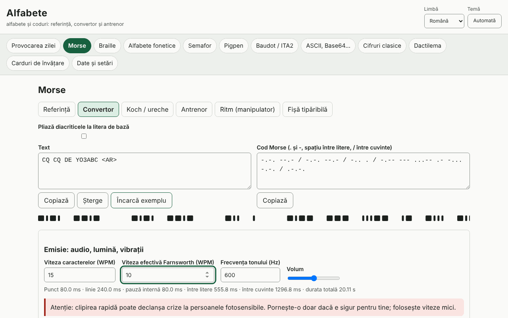

# Alfabete

[English](README.md) · **Română** · [Français](README.fr.md) · [Italiano](README.it.md) · [Español](README.es.md) · [Português](README.pt.md) · [Deutsch](README.de.md) · [Magyar](README.hu.md)

**Versiune:** 2.2.0 · **Ultima actualizare:** 2026-10-27

**Stare:** stabil · **Offline:** complet (fără cereri de rețea)

Limbile interfeței: **Română, English, Français, Italiano, Español, Português (PT), Deutsch, Magyar**

Alfabete este o aplicație offline pentru alfabete și coduri: pentru fiecare cod ai o referință vizuală, un convertor în ambele sensuri, un antrenor cu verificare și o fișă tipăribilă. Acoperă Morse (audio cu WPM/Farnsworth, lumină, vibrații, Koch, ureche, ritm), braille latin de grad 1 (Unicode, BRF, SVG, scriere Perkins), alfabete fonetice (ITU/NATO, românesc, DIN 5009, francez), semafor, pigpen, Baudot/ITA2, ASCII/binar/hex/octal/Base64/URL/escape Unicode, cifruri clasice cu pași explicați și analiză de frecvență, provocarea zilei și carduri cu repetiție spațiată (SM-2). Completează aplicațiile Eter (Morse/Koch) și Atingere (braille).

**Live:** https://chiuta.github.io/apps/Alfabete/

## Cum se folosește

Alege un panou din bara de sus, apoi o subfilă: Referință, Convertor, antrenor, Fișă tipăribilă. În convertoare scrii în oricare dintre câmpuri, iar celălalt se actualizează. La Morse poți reda sunetul, lumina sau vibrația (unde browserul permite) și exporta WAV. La braille poți descărca BRF sau SVG. „Provocarea zilei” se generează determinist din dată. Limba (ro, en, fr, it, es, pt, hu, de) și tema (automată/luminoasă/întunecată) se schimbă din antet; textul introdus se păstrează.

## Ce NU face și limite

- Braille: doar **grad 1** (literă cu literă). Gradul 2 (contracții) nu este implementat și nu este pretins. Literele românești (ă â î ș ț) nu au fost verificate față de o sursă oficială: sunt oferite profiluri selectabile (de lucru, pliere la litera de bază, personalizat), marcate ca atare. Punctuația variază între limbi.
- Alfabetul fonetic românesc, diacriticele Morse și variantele naționale nu sunt standardizate; sunt marcate „neoficial”/„variantă”. Cele ITU/NATO și semnele ITU-R M.1677-1 sunt cele standard.
- Dactilema: **fără figuri** (nu desenăm mâini aproximative); doar descrieri scurte și trimitere la surse oficiale. Descrierile ASL și sensul prosign-urilor apar în engleză în afara limbilor ro/en.
- Semaforul: tabelul a fost verificat încrucișat cu o sursă publică, dar merită verificat cu o sursă oficială; semnele pentru cifre și anulare nu sunt desenate.
- Cifrurile clasice sunt didactice, **nu oferă securitate**. Atacul asupra Cezar/Vigenère funcționează pe texte suficient de lungi, în engleză sau cu frecvențe proprii.
- Vibrațiile depind de API-ul Vibration (lipsește pe iOS/desktop); lumina rapidă poate afecta persoanele fotosensibile.

## Confidențialitate

Rulează local, nu trimite nimic nicăieri. Singurele date (setări, statistici, carduri, ciorne) stau în localStorage sub prefixul `fff.alfabete.`.

## Formate

Export/import de date: `.fff.json` (format `fff-bundle`, schema 1). Ieșiri: WAV (Morse), BRF și SVG (braille), fișe tipăribile (print/PDF).

## Tehnic

Un singur fișier `index.html`, JS și CSS inline, CSP strict cu hash, fără resurse externe. Teste: `node tests/test.mjs` (Playwright; 44 de teste: vectori cunoscuți, dus-întors pentru fiecare cod, durate Morse calculate și măsurate pe audio randat/clipire, axe 0 în ambele teme, layout la 360 și 1280 px).

## Terți

Nu folosește cod de la terți.

## Traduceri

Româna și engleza sunt scrise de mână; franceza, italiana, spaniola, portugheza, maghiara și germana sunt traduceri automate, neverificate de vorbitori nativi.

## Licență

MIT — vezi fișierul `LICENSE` din rădăcina depozitului.

## Noutăți 2.1.0 și ce nu este implementat (2026-10-27)

- **Rundă cronometrată (60 s)** la fiecare antrenor (Morse, braille, fonetic, semafor, pigpen, Baudot, ASCII/binar, cifruri): butonul pornește un cronometru de 60 s, trece automat la următoarea întrebare după fiecare răspuns și la final afișează câte răspunsuri corecte ai dat și **cel mai bun rezultat** (păstrat local, în `stats`, fără o cheie nouă de stocare). Textele sunt în toate cele 8 limbi (fr/it/es/pt/hu/de automat).
- **Audio pentru Morse**: exista deja (sunet cu WPM/Farnsworth, lumină, vibrație, export WAV) — nemodificat.
- **Braille grad 2** (contracții): **gradul 2 complet rămâne planificat, neimplementat** (2.2.0 adaugă doar un mod parțial de semne-cuvânt pentru engleză, vezi mai jos). Rămâne doar gradul 1 în rest, cum este deja declarat în „Limite”; contracțiile depind de limbă și de cod (de ex. UEB pentru engleză) și nu pot fi adăugate fără o sursă oficială verificată; nu am introdus tabele din memorie.
- Avertismentul despre cifrele clasice (didactice, **fără securitate**) rămâne neschimbat.

## 2.2.0: braille grad 2 parțial pentru engleză (2026-10-27)

- **Grad 2 parțial, doar engleză** (bifă în Braille → Convertor): numai **semnele-cuvânt pentru cuvinte întregi** — cele 23 de semne alfabetice (but, can, do, every, from, go, have, just, knowledge, like, more, not, people, quite, rather, so, that, us, very, will, it, you, as; celula este cea a literei) și cele cinci contracții puternice ca cuvinte întregi (and ⠯, for ⠿, of ⠷, the ⠮, with ⠾). Surse: cursul NFB Braille, lecția 4 (§4.2–4.3, cu numerele punctelor) și Paths to Literacy, lecția 5 (lista semnelor alfabetice). Cuvintele în contact cu apostrof, cratimă, bară sau cifră rămân necontractate (regulile din surse pentru aceste cazuri nu au fost verificate complet). Majusculele folosesc indicatoarele obișnuite. Decodarea rămâne grad 1.
- **Nu este UEB grad 2 complet**: fără semne de grup (ch, sh, th, ing…), forme scurte, semne inferioare, folosirea „the/and/for…” în interiorul cuvintelor sau regulile pentru cuvinte compuse. **Nu este pentru română.** Nu a fost revizuit de un transcriitor braille.
- Teste: `tests/braille-g2.test.mjs` (48 de verificări, inclusiv toți cei 28 de vectori de semne).
- Existau deja (nemodificate): runda cronometrată de 60 s, audio Morse.

## Istoric

- 1.0.0 — 2026-10-14: prima versiune
- 1.0.1 — 2026-10-19: panoul se alege doar din partea dinaintea primului „&” a adresei (#panou&from=…), ca linkurile din ETER/INDICATIV să deschidă panoul corect.
- 2.1.0 — 2026-10-27 (anterior: 1.0.1): rundă cronometrată de 60 s la antrenori; braille grad 2 rămâne planificat.
- 2.2.0 — 2026-10-27 (anterior: 2.1.0): braille grad 2 parțial pentru engleză (doar semne-cuvânt).
